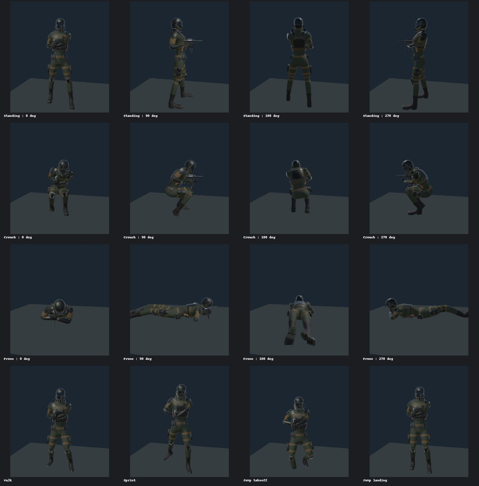

# Native Unity QA — CC0 Quaternius anatomical prone (20 November 2026)

## Exact revision and provenance

- **Source code blob:** `fd5c0a16324e65e5d09308f1385a418aeff9b920` in `Assets/AarisWorld/Scripts/AarisCharacterVisual.cs`.
- **Resources:** four independently extracted Unity Humanoid `.anim` assets from Quaternius Universal Animation Library (CC0 1.0), including `Crawl_Idle_Symmetric.anim`, a derivative with symmetric leg-muscle curves. Attribution is in `Docs/ThirdParty/QuaterniusUAL_CC0.txt`.
- **Runtime:** Unity Editor 6000.3.26f1, Linux Codespace, persistent detached test worktree `/workspaces/Aris-Stance-QA`. The original working tree with 30 modified files was not reset.
- **Native test:** `Aaris.MapReview.Editor.AarisPoseFrames.CaptureMultiAnglePortrait`, native exit code **0**, result `SUCCESS_16_ACTOR_MULTIANGLE_PORTRAITS`.
- The accompanying 4×4 contact sheet is assembled **only from actual Unity camera screenshots**, not generated by AI or a manually posed image.

## Result

**PASS for the native 16-frame pose harness**: Standing 0°/90°/180°/270°, Crouch 0°/90°/180°/270°, Prone 0°/90°/180°/270°, one Walk frame, one Sprint frame, and two Jump frames.

Measured settled Prone at the real terrain surface:

| Metric | Left | Right |
| --- | ---: | ---: |
| Ankle clearance | 0.075 m | 0.075 m |
| Knee clearance | 0.259 m | 0.183 m |
| Lateral knee offset | 0.029 m | 0.029 m |

Knee height difference: **0.075 m**. The prior imported VRChat prone failed with substantially misplaced/inverted mesh; the intermediate CC0 symmetric pose failed knee height or boot contact until common bone-derived reach and the single (non-doubled) measured ankle clearance were resolved.

Three project Python source-level regressions passed on the **same code blob**:

- `test_vendor_mit_stance_integration.py`
- `test_balanced_low_stance_ik.py`
- `test_character_pose_and_curved_ice.py`

## Scope and limitations

Standing keeps its proven original animation. CC0 provides new crouch idle/walk and prone crawl idle/forward clips. The settled prone posture avoids VRChat-specific fixed rig lowering and secondary chest/head/leg IK, using measured bone lengths, anatomical hip axis, real terrain support and a two-bone solver.

**Not yet verified:** Android device FPS, exact weapon support-hand grip, slope extremes, multiplayer synchronization, and full-length player input playthrough. Passing 16 screenshots is not proof of these cases.

## Screenshot

